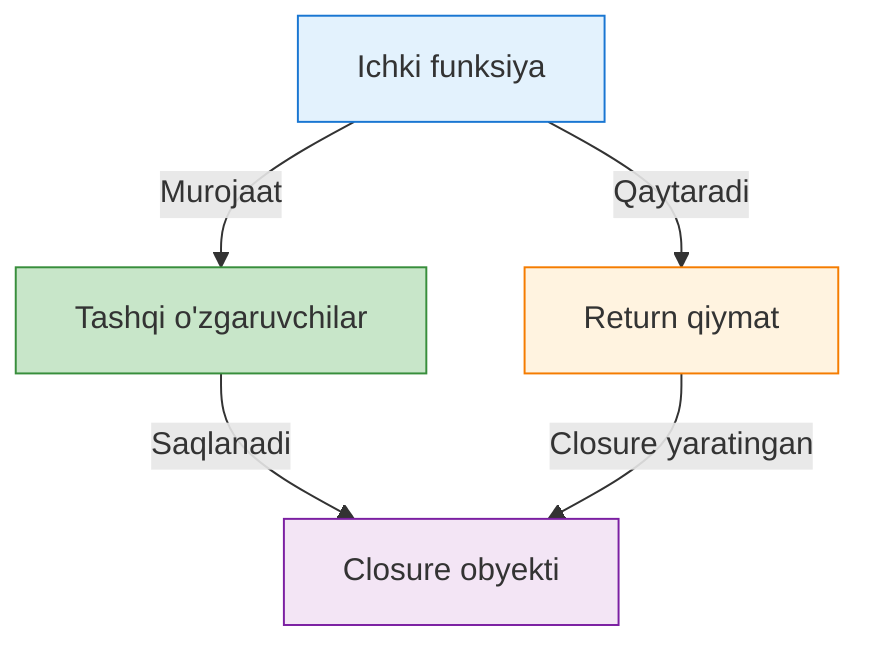

# 📚 Closure (Yopilma) — Dahshatname

## 📦 Tushunchalarning sodda izohi

**Closure** — bu inside Function navigating tashqi osonli o'zgaruvchilarga murojaat qilib, ular o'chib ketmagan holda qolgan "yopilma" funksiyadir.

Oddiy tuhfat:
- Ichki funksiya tashqi uchun "yl" ajratadi
- Tashqi o'zgaruvchilarni "o'rganib qolgan" va ularni qayta ishlash imkonini beradi
- `this` kalit sozni aniqlash uchun "bag'ish" hosil qiladi

*Oddiy misol:* `function outer() { const name = "JavaScript"; return function inner() { console.log(name); }; }`

## 💻 JavaScript kod namunalari

### To'g'ri misol:

```javascript
function createCounter() {
  let count = 0;
  
  return {
    increment: function() {
      count++;
      return count;
    },
    decrement: function() {
      count--;
      return count;
    },
    getCount: function() {
      return count;
    }
  };
}

const counter = createCounter();
console.log(counter.increment()); // 1
console.log(counter.increment()); // 2
console.log(counter.getCount());  // 2
```

### Noto'g'ri misol (closure yo'q):

```javascript
function brokenCounter() {
  let count = 0;
  
  function increment() {
    count++;
  }
  
  // count ni tashqi ga qaytara olmadik — closure yo'q
  return "done";
}

const result = brokenCounter();
// result.count ga murojaq bolmadi — closure yo'q
```

## ✅ To‘g'ri va ❌ noto‘g‘ri yondashuvlar

### ✅ To'g'ri:

- **O'zgaruvchilarni saqlash:** `counter.count` ni unga tegirmasdan saqlash imkoniyati
- **Private maydonlar:** `count` " privat" bo'lgan deb hisoblanadi, user `increment()` yordamida faqat o'zgartirishi mumkin
- **Memory efficiency:** Yangi obyekt yaratish qiyin bo'lsa, closure yordamida o'z o'zi bilan ishlash mumkin
- **Event handlers:** Hodisalarda ma'lumotlarni davom ettirish uchun

### ❌ Noto'g'ri:

- **Global polluting:** `count` o'zgaruvchisi global funksiyaga bog'liq bo'lsa, u ajralishi mumkin
- **Memory leaks:** Chunki closure'larda "o'zgaruvchilar oldini olinmaydigan" vaqt o'tganda, ularni "garbage collection" tozalaydi
- **Unexpected behavior:** `this` kalit so'zining yagona funktsiyaning ichida o'zgarishi mumkin
- **Debugging complexity:** Closure o'zgaruvchilarining "qayerdan kelgani" haqida o'ylash qiyin bo'ladi

## 🎩 Hayatiy o‘xshatishlar

- **Uzgaruvchan "xotin":** Closure — shu "xotin" kabi, u ichida qolgan "mahsulotlar" (o'zgaruvchilar) bilan ishlashi mumkin bo'ladi, lekin tashqarisiga ko'proq ehtirokga ochiq
- **"Yol" ajratmasi:** Closure — shu yo'l -- shu ustun -- orqali foydalanuvchi boshqa funksiyalarga (tashqi) murojaat qilib, ularni saqlash imkonini beradi
- **Temporizr yozish:** `setTimeout`, `setInterval` kabi vaqtlar yig'inish funksiyalari ajratib yuborishda yordam beradi
- **Modular kod:** Modullar (modules) yaratish va ular orasida xabar o'tkazish uchun keng qo'llaniladi

## 📊 Mermaid diagrammasi



Diagrama tushuncha:
1. **Ichki funksiya** yaratilganda
2. U tashqi o'zgaruvchilarga murojaat qiladi
3. `return` orqali chiqganda ham, closure "o'zgaruvchilarni saqlaydi"
4. Result — **Closure obyekti** (funktsiya + ujihlangan xotira)

## 🎙 Intervyu savollari va javoblari

### S1: Closure nima ekanligini qisqariqli aytqing?

**Javob:** Closure — bu ichki funktsiya tashqi bo'yaligiga barchasidan so'ng ham murojaat qilib, shu o'zgaruvchilarni "o'rganib qolgan" va ularni qayta ishlash imkonini beradigan dasturlash tushunchasi. Oddida, funktsiya tugaganlorga bagsa, u ichidagi o'zgaruvchilar oldini olinmaydi.

### S2: Closure misolida "memory leak" xatoni bashorat qiling?

**Javob:** Ha, closure'larda memory leak mumkin. Agar big o'lchamli ma'lumotlar (masalan, 10000 ta elementli massiv) closure ichida saqlansa, ular "garbage collection" yordamida o'chirilmaydigan holda qoladilar, bu proqramni yavaşlagir. Shuning uchun, foydalanilmasa bo'lgan closure'lardan baxtinoz do'sturish yoki ularni yoqish mosdir.

### S3: Quyidagi kod natijasini aytqing:

```javascript
function outer() {
  let secret = "SIR";
  return function inner() {
    console.log(secret);
  };
}

const myFunc = outer();
myFunc(); // Natija: "SIR"
```

**Javob:** `myFunc` — bu `outer()` funksiyasining qaytarilgan `inner` funksiyalari. Chunki `outer` tuganda ham, `inner` "secret" o'zgaruvchisini "o'rganib qolgan" holda saqlab turgan. Shuning uchun, `myFunc()` chaqirganda ham "SIR" natijasini chop etadi, chunki closure o'zgaruvchini saqlab qolgan.

### S4: Closure va "this" kalit so'z o'rtasidagi farq nima?

**Javod:** `this` — brauzer yoki oshakda jisralgan o'zgaruvchi (window, undefined kabi), shuning uchun closure ichida `this` funksiyaning "turidagi" o'zi bo'lsa, tashqi `this` emas. Chunki closure maqsadi — o'zgaruvchilarni saqlash, shuningdek, `this` uchun `.call`, `.apply` yoki `.bind` yordamida soddalashtiriladi.

### S5: Keyinchalik dasturda closure'larni qanday foydalanishni xohlaysiz?

**Javob:** Men quyidagilardan foydalanishni xohlayman:
- **Private maydonlar** obyektarga murojaat qo'llanib, `this.count` dan tashqari `counter.increment()` yordamida faqat o'zgartirish
- **Event handlers** hodisalari oralig'ina ma'lumotlarni (masalan, hisoblash natijalari) saqlash
- **Modullar** (modules) yaratish va ular orasida xabar o'tkazish, balki chunda bunday qo'llanish eng samarali, chunki ular xotira menyuslarini "ochiq" tutishga ruxsat beradi, lekin them to'liqini boshqarish kerak